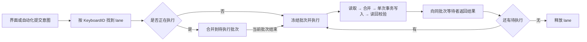

# 设备连接与配置写入队列

菜单栏、主窗口和各个自动化入口都会写同一把键盘的配置。本文说明设备连接状态的呈现方式，以及共享写入队列怎样合并请求、处理断连并避免界面回跳。

## 行为

- 主窗口「已连接」列表只含仍枚举的设备。当前详情在断连后保留，放进「已断开」，保留草稿和固件升级的重启上下文；缓存的状态标为上次读取。
- 菜单栏只用可用设备列表。断连后清除实时状态和待执行的意图；没有设备时显示连接提示，配置操作不可用。
- 多把同型号键盘以 `KeyboardID` 区分并显示位置标识。切换设备不会把旧设备的读回或排队意图带到新设备。
- 首次读取成功后，配置档、灯效、亮度、速度、颜色和预设在写入期间保持可操作：界面显示最新的用户意图，读取或写入的中间结果不会让控件回跳。写入期间显示「正在配置键盘…」提示，它画在固定位置的 overlay 上，不改变面板高度（改变高度会让菜单栏窗口逐帧改尺寸，见 [性能](performance.md#菜单栏面板高度与-hitch)）。
- 主窗口保持显式「写入键盘」的草稿语义：保存期间可以继续编辑和再次提交，后续提交合并；失败时保留草稿。

## 写入队列契约

`KeyboardConfigurationWriter` 是 App 生命周期内共享的 actor，由组合根（`CoreServices`）创建。菜单栏、主窗口和自动化通过同一个依赖客户端提交，避免各自串行却在设备上互相穿插。

- 每个 `KeyboardID` 一条 lane：最多一个执行中批次和一个待执行的合并批次，各有唯一 token 和等待者列表。设备空闲时新请求立即执行；设备忙时只合并进待执行批次，执行中的批次保持冻结，不因新操作取消。
- `ConfigurationIntent` 持有 `[profile: ProfilePatch]` 与可选的激活目标。补丁明确记录修改的字段和值，以明确的配置档编号为目标，不依赖执行时的「当前配置档」（自动化入口不指定配置档时用 `activePatch`，在事务内按读到的当前档落位）。
- 同一批次的所有等待者收到同一个最终读回。设备之间相互独立，可以并行。

`KeyboardConfigurator.apply` 在一次独占的私有协议通道内处理整批：校验型号、配置档与灯效，读取完整配置，按字段生成目标配置，只写变化的字节范围，最后执行激活。多个配置档的修改共用一次 `0x01` 开始 / `0x02` 结束，再读回完整配置，校验请求的字段和激活结果。没有变化时跳过事务。

### 合并与异常

| 输入或事件 | 行为 |
|---|---|
| 同配置档、同字段连续修改 | 采用最后的值，包括改回原值 |
| 不同字段或不同配置档 | 分别保留，后一个完整快照不会覆盖前一个意图 |
| 连续切换配置档 | 只保留最后的激活目标；已明确提交的配置档修改仍保留 |
| 一个批次失败 | 该批次的等待者收到错误；后续批次继续，下一批重新读取设备基准 |
| 断连或私有接口被替换 | 立即拒绝旧请求：取消执行中的批次（仍尽力发送结束命令）、清空待执行批次；旧 worker 结束后才允许重连后的请求使用 lane |
| 页面隐藏或调用方不再等待 | 已提交的设备写入继续；页面按请求身份或代次丢弃过期结果 |

接口身份也参与连接有效性判断：即使快速拔插的中间空列表被发现流合并掉，同一 `KeyboardID` 的新接口也会结束旧会话。组合根在发布发现结果前先更新写入队列的连接集合，界面的旧快照不能在断连后继续提交。

## 界面侧

- **菜单栏**：以已校验的配置为基准，叠加当前设备尚未确认的意图来呈现。请求序号阻止较早完成的回调覆盖较新的确认；快照修订号阻止先发出的读取覆盖新意图。已有快照时，写入期间不启动轮询或手动刷新。
- **主窗口**：第一次保存冻结补丁，再次保存冻结并合并待执行补丁；提交之后继续编辑、没有再次保存的字段仍是草稿。保存上下文记录提交后编辑过的字段，保护「改回旧基准」和外部同步发生时的本地修改。断连保留详情与草稿并禁用配置动作，重连后自动读取新基准。
- **读回分发**：写入成功后，Core 的 `ConfigurationChange` 携带已验证的读回，直接更新设备信息页和编辑页，不再触发全量重读；编辑页按 dirty 字段 rebase，保留草稿。

## HID 适配器

设备发现时缓存接口属性，以对象 token 删除原始接口；拔出后不再查询已失效的 registry 属性。最后一个接口移除后设备消失；配置接口先移除时，配置控件立即不可用。

## 验证

- 单元：`ConfigurationWriterTests`（字段合并、配置档交错、多设备独立、失败与断连代次、无变化不重复写入）、`ConfigurationQueuedSaveTests`、`ConfigurationSynchronizationTests`、`MenuBarBranchTests`、`HIDDiscoveryInventoryTests`。
- 模拟场景：`dual`（两把同型号键盘）、`slow`（每个 HID 回复延迟 180 ms）。
- UI：菜单栏双设备切换与隔离、慢写期间持续操作、主窗口保存期间编辑与重复提交、热插拔恢复（见 [UI 测试用例](ui-tests.md)）。真机上用 UI-94 验证过 USB 拔插。
