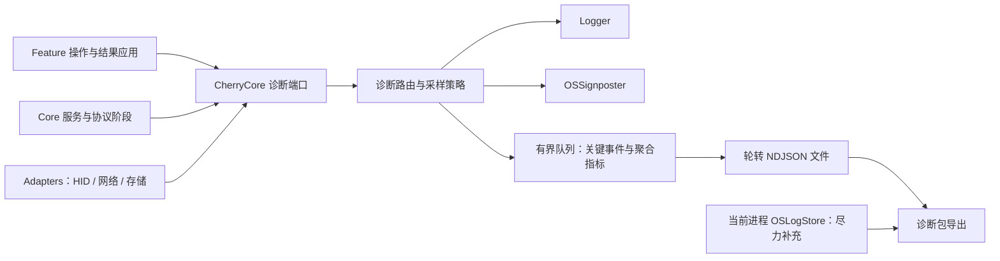

# 诊断日志与 Profile 工具

App 的观测由同一份类型化事件驱动三个出口：`Logger`（Console / Xcode 实时查看）、`OSSignposter`（Instruments 时间线）和有界的本地诊断文件（用户导出 `.cherrydiag.zip` 反馈问题）。本文说明契约、数据保护、容量与导出格式，以及 Release Profile 工具的用法。



## 模块

- **CherryCore/Diagnostics**：事件、结果与错误代码、`TraceContext`、span 契约和端口 `Diagnostics`（`.noop` / `.recording`）。Core 不依赖 `os`，也不含 Logger 名称或界面文案（`ArchitectureTests` 检查）。
- **CherryAdapters/Diagnostics**：OSLog / signposter 映射（`DiagnosticOperation+OSLog`）、模式与采样策略、journal writer（轮转、恢复、保留）、当前进程系统日志读取、导出与 manifest、ZIP 写入。所有限额集中在 `DiagnosticPolicyConfiguration`，manifest 写的是实际生效值。
- **CherryFeatures/Diagnostics**：诊断窗口的 reducer 与视图（模式、导出进度、内容摘要、失败与重试），观测调用只在 effect 里执行。
- **App**：`DiagnosticsComposition` 创建一次诊断基础设施并注入；菜单栏「诊断」与 Help →「诊断与日志…」（⌘⇧D）打开同一个窗口。

## 日志契约

subsystem 为 `online.odeployer.CherryUtility`，category 是固定集合：`app`、`discovery`、`channel`、`hid`、`configuration`、`firmware`、`network`、`storage`、`keytest`、`diagnostics`；App 另有 `launch`（启动方式探针）与 `control`（控制 socket）两个只写系统日志的 category。category 不含设备 ID、操作 ID 或文件名。

| 级别 | 用途 |
|---|---|
| debug | 受控细节；热路径采样 |
| info | 成功摘要、聚合指标 |
| notice | 低频的重要状态或可恢复异常（启动、用户写配置、断连、丢弃摘要）。需要 warning 语义时用 notice 加 `reason_code` |
| error | 操作失败（超时、设备拒绝、读回不一致、日志写入失败） |
| fault | 内部不变量被破坏（例如同一 span 重复终结） |

取消、用户关闭页面、设备正常重启分别记为 `cancelled`、`stopped`、`device_rebooted`，不记成 error。OSLog 的 info 默认只在内存中，要持久保存的事件用 notice 及以上。

**事件字段**（文件与导出使用同一份白名单）：`schema_version`、`event_code`、`category`、`level`；`record_id`（= `run_id` + 进程内递增的 `sequence`）；`wall_time_utc` 与单调的 `elapsed_ns`；`trace_id`、`span_id`、`parent_span_id`；`device_session_id`（连接实例的随机 ID）、`origin`；`operation`、`phase`、`outcome`；`duration_ns` 等统一以纳秒计的数值；`error_domain` / `error_code` / `reason_code`；采样与聚合事件标明 `sample_rate`、`aggregation_window_ns`。

### 数据保护

- 只接受枚举和数值，不记录 `error.localizedDescription`、TCA action / state、HID 报文、领域对象的描述或任意字符串。白名单数值包括 VID/PID、usagePage、reportID、协议命令 / 偏移 / 长度、配置档编号和修改的字段名。
- 不记录：配置值、预设名、序列号、locationID、registryID、用户路径、URL query / header、文件内容、固件字节、按键内容和按键顺序。按键测试只记计数、延迟分布、丢弃数和采集生命周期。
- Logger 插值只用固定字面量模板，`record_id`、`trace_id` 这类随机标记标 `.public`；不先拼字符串再整体标为 public。OSLog 的隐私遮盖不承担文件脱敏，文件在源头只接受白名单字段。

## Trace 与 signpost

- 每次启动一个 `run_id`；每次用户操作或后台轮询一个根 `trace_id`，各阶段各有 `span_id`。上下文用 `@TaskLocal` 传播，IOKit 回调、取消回调和进度闭包显式捕获。
- `origin`（`menuBar`、`deviceInfo`、`configuration`、`firmware`、`keytest`、`automation`、`app`、`profile`、`background`）只由驱动侧（Feature effect 或客户端包装）声明，Core 服务和适配器只继承（`ArchitectureTests.calleesNeverDeclareAnOrigin`）。
- span 的 finish 同步且幂等；成功、异常、取消、超时、断连都只终结一次，句柄释放时只能补 `abandoned`。noChange 是 `configurationWrite` 的一种终态，不单独发事件。进程异常退出留下的未闭合 span 在下次启动时标为 `incomplete`。
- signpost 名称是有限的 `StaticString` 集合（`ChannelQueue`、`ChannelOpen`、`ChannelHeld`、`HIDSchedule`、`HIDSend`、`VendorExchange`、`ConfigurationWrite`、`FirmwareParse`、`OTAStart`、`OTATransfer`、`OTAResult`、`ReconnectionVerify` 等），设备 ID 放 metadata；每个可能并发的 interval 用 `makeSignpostID()`。
- 观测不能改变业务行为：通道闸门的公平性、mailbox 的超时竞速、事务结束清理和 OTA 应答都与诊断开关无关。锁内只更新计数，锁外才 emit；HID 线程上不编码 JSON、不写文件。
- 领域类型不携带观测字段：按键事件的诊断时间戳由外层 `Traced<KeyEvent>` 携带，只能通过 `Diagnostics.elapsed(since:)` 与同一时钟比较。

## 模式与容量

| 模式 | 内容 | 时长 |
|---|---|---|
| 标准（默认） | 启动 / 连接变更、用户写入终态、受限的错误、操作摘要；高频路径（输入、OTA 应答）按固定桶聚合 | — |
| 详细 | 标准加协议元数据、调度与排队详情；高频阶段 1/64 采样 | 15 分钟后回到标准 |
| Profile | 标准摘要加指定路径的采样，用于开发复现 | 10 分钟后回到标准 |
| 关闭 | 诊断端口为 noop，不构造事件 | — |

- 入口是同步的有界缓冲：普通队列 2,048 条，重要终态另留 256 条；单条事件编码后不超过 1 KiB。超限时优先丢最旧的普通记录，丢弃数量按原因计数并写进导出包。
- 一个后台 writer 批量写入（每 256 条、64 KiB 或 1 秒），调用方不等待磁盘。重复错误按（事件、错误码、设备会话）限流，每 10 秒汇总一次。
- 直方图用固定桶，只存 count / min / max / sum 与桶计数；p50 / p95 是桶近似值。详细与 Profile 模式每个 trace 每分钟最多 256 个高频样本、最多同时追踪 128 个 trace；每个操作每分钟最多 30 条独立的高频失败，失败仍进入完整聚合。

## 文件与保留

- 位置：`~/Library/Application Support/CherryUtility/Diagnostics/`，目录 0700、文件 0600。模拟模式默认关闭日志，`CHERRY_DIAGNOSTIC_MODE=standard|detailed|profile|off` 可以指定，`CHERRY_DIAGNOSTIC_DIR` 只用于模拟测试。
- NDJSON 分段，每段最多 4 MiB，总量 32 MiB，最长保留 7 天，按最旧的完整分段淘汰。每次运行写 session 元数据（版本、系统、架构、是否模拟、策略版本）。
- 启动时只恢复未正常结束的当前分段，截断损坏的尾行并计数；缺少正常关闭标记只能标为「未正常结束」，不认定为崩溃。
- 磁盘满或权限错误时暂停文件写入，保留内存与 OSLog 输出，界面提示「部分日志不可用」，不影响键盘操作。

## 导出

诊断窗口可选最近 15 分钟、本次运行或最近 24 小时，后台生成后展示大小、条数与不完整提示，再用系统保存面板另存。导出包 `.cherrydiag.zip`（stored 格式，不调用外部压缩程序，单包上限 20 MiB）：

```text
manifest.json       格式与策略版本、export_id、运行列表、实际时间范围、环境摘要；每个文件的字节数与 SHA-256
events.ndjson       白名单事件，按 run 和 sequence 排序
metrics.json        按阶段、来源和场景聚合的指标、单位、样本数与桶边界
system-log.ndjson   可选：当前进程 OSLogStore 中能识别的本项目事件
README.txt          中文说明：缺失来源、采样、丢弃、取消
```

- 导出以开始时的 `sequence` 为截止点，在 writer 的串行队列上读取已选分段，等待写入最多 2 秒，整个导出 30 秒预算；超时或取消返回可重试的失败并清理临时文件。临时包 24 小时后清理；用户保存到外部的文件由用户管理。
- 系统日志只用 `OSLogStore(scope: .currentProcessIdentifier)` 尽力补充当前进程，最多 10,000 条 / 5 MiB；只解析本项目已知的固定模板，无法安全识别的消息只计数。读取系统范围的日志需要管理员权限，App 不依赖它。
- manifest 的 `truncated`、`dropped`、`incomplete_spans`、`journal_status` 等字段标明证据是否完整；SHA-256 用于完整性核对，不代表匿名化或加密。
- 诊断包不含固件文件、预设文件、按键记录或 `.trace`，也不会自动上传；网络提交没有实现。

## 查看日志

```bash
/usr/bin/log stream --level debug --style compact --predicate 'subsystem == "online.odeployer.CherryUtility"'
```

```bash
/usr/bin/log show --last 15m --info --debug --style ndjson --predicate 'subsystem == "online.odeployer.CherryUtility" AND category == "channel"'
```

在 zsh 里 `log` 是内建命令，要写全路径 `/usr/bin/log`。`--info` / `--debug` 只是显示选项，不代表历史记录完整。Instruments 里添加 Time Profiler 与 os_signpost（Points of Interest），按 subsystem 过滤即可看到上述 span。

## Profile 工具

`CherryProfiler` 是 Release 构建的命令行工具：模拟设备 + 真实 Core 服务 + `KeyTestFeature` reducer，按顺序比较关闭 / 标准 / Profile 三种观测模式的开销。

```bash
python3 Scripts/run-diagnostic-profile.py --repetitions 1 --input-seconds 60 --idle-seconds 300
```

- 每次运行生成 `build/profile/<run>/`：`identity.json`（源码与二进制摘要、工具链、硬件）、每个模式的 `scenario.json`、同一进程的诊断包和汇总。构建前后与运行结束都比对源码摘要，防止混入不同版本。
- `--repetitions 3` 轮换模式顺序用于复验；`--official-updater <文件>` 只解析指定的官方升级包，不刷写任何设备。
- 工具校验所有文件的 SHA-256、禁止字段、丢弃数与 span 闭合，失败时非零退出。

| 场景 | 输入 | 回答的问题 |
|---|---|---|
| S1 | empty / pixiu75，各 10 次 | 服务初始化与首次读取 |
| S2 | 1 ms 回复，30 次串行、100 次并发 | 通道排队与尾延迟 |
| S3 | 100 次亮度修改及读回 | 写入与读回耗时 |
| S4 | 每秒 1000 个按键事件，60 秒 | 事件派发到 reducer 的延迟、发送 / 消费数与聚合开销 |
| S5 | 官方升级包或合成文件，10 次 | 解析与 OTA 报文生成 |
| S6 | 合成 OTA、1 ms 应答、重连 CRC 核对及取消 | 传输、重连与取消清理 |
| S7 | 5 分钟模拟轮询 | 常驻诊断文件增长与 CPU |

S4 的 60 秒对照中，标准与 Profile 模式相对关闭模式的 CPU 增加约 11% 与 6%（各约 1.1 秒 / 0.6 秒，6 万个事件全部消费、零丢弃），高于最初 3% / 5% 的目标；Instruments 中 MD5、OTA CRC 与资源查找是固件解析的主要耗时。这些是模拟数据，不代表真实 HID、窗口绘制或网络。App 层面的性能工作见 [性能](performance.md)。
