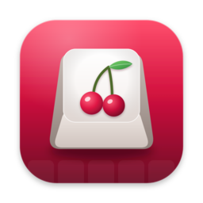
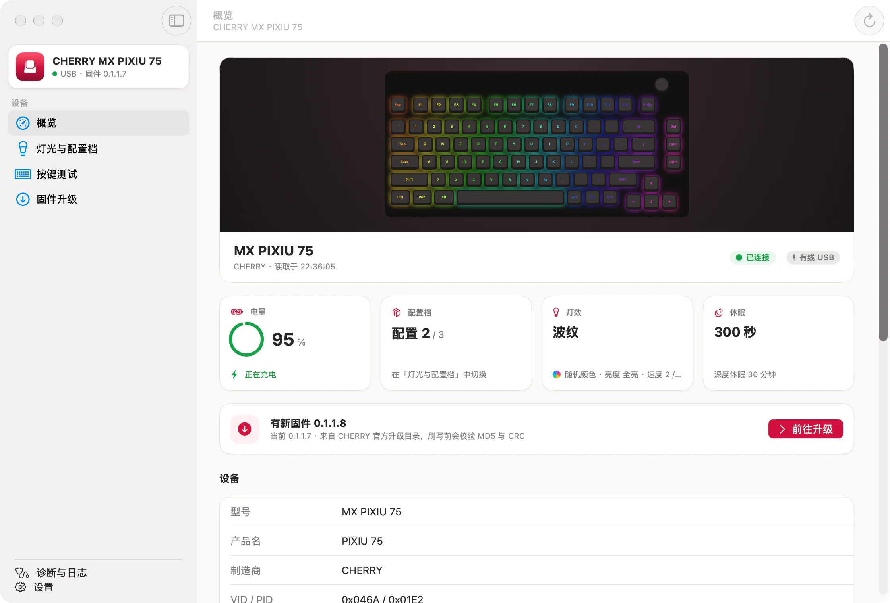

<p align="center">
  
</p>

<h1 align="center">CHERRY Utility for Mac</h1>

<p align="center">
  给 Mac 用户的 CHERRY 键盘工具（非官方）：灯效、配置档、按键测试、固件升级，<br>
  以及快捷指令、命令行和 MCP 自动化。
</p>

<p align="center">
  <a href="https://odeployer.online/cherry-utility/"><b>官网与下载</b></a> ·
  <a href="Docs/guide/getting-started.md">使用指南</a> ·
  <a href="Docs/README.md">全部文档</a> ·
  <a href="https://odeployer.online/cherry-utility/#changelog">更新日志</a> ·
  <a href="#english">English</a>
</p>

<p align="center">
  <a href="https://github.com/0xfeedface1993/cherry-utility-mac/releases/latest"></a>
  
  
  <a href="LICENSE"></a>
</p>

<picture>
  <source media="(prefers-color-scheme: dark)" srcset="Website/src/assets/screens/overview-dark.webp">
  
</picture>

CHERRY 官方驱动只有 Windows 版。CHERRY Utility 是一个原生 macOS App，通过与官方驱动相同的 USB 配置协议工作：常驻菜单栏，随手切换灯光；所有修改写进键盘自己的配置空间，接到其他电脑上同样生效。

## 功能

- **菜单栏常驻**：电量一眼可见；切换配置档、灯效、亮度、速度和颜色，载入预设，不用打开窗口。
- **灯光与配置档**：三个板载配置档逐项编辑（灯效、亮度、速度、颜色、两级休眠），先存草稿，确认后只写入改动的字段并读回核对。
- **本地预设**：把喜欢的灯光存成预设，导入 / 导出 `.cherryprofile` 文件。
- **按键测试**：在型号的真实键位图上实时显示按键状态，包括旋钮。
- **固件升级**：使用 CHERRY 官方升级包，校验 MD5 与 CRC 后经 USB 刷写，刷完读回核对。
- **自动化**：10 个[快捷指令 / Spotlight 动作](Docs/guide/shortcuts.md)、[命令行 `cherry`](Docs/guide/cli.md)、给 Claude 等 AI 助手用的 [MCP 服务](Docs/guide/mcp.md)。
- **自定义固件**（实验性，默认隐藏）：在原厂固件上固定 F 区行为、去掉 Ctrl+Fn 误触等，见[说明](Docs/guide/custom-firmware.md)。
- **本地优先**：没有账号和统计上报；诊断记录只保存在本机。

## 下载

从 [官网](https://odeployer.online/cherry-utility/) 下载 DMG（macOS 15+，Apple 芯片与 Intel 通用，Developer ID 签名并经 Apple 公证）。App 内置 Sparkle，会自动检查更新。命令行工具 `cherry` 也可以在官网单独下载。

安装与第一次使用见 [安装与上手](Docs/guide/getting-started.md)。

## 自动化一览

**快捷指令 / Spotlight**：在快捷指令编辑器的「App › CHERRY Utility」里添加动作，或在 Spotlight 输入「用 CHERRY Utility 切换到配置 2」。→ [指南](Docs/guide/shortcuts.md)

**命令行**：

```bash
cherry status                              # 电量、连接、固件和三个配置档
cherry set --effect 呼吸 --brightness 高    # 只写指定的项
cherry profile 2 --json                    # 机器可读的输出
```

→ [命令行参考](Docs/guide/cli.md)

**MCP**：注册到 Claude Code 后，可以直接说「把键盘切到配置 2，灯效换成呼吸」：

```bash
claude mcp add --scope user cherry -- /Applications/CherryUtility.app/Contents/MacOS/cherry mcp
```

→ [MCP 指南](Docs/guide/mcp.md)（含 Claude Desktop 与其他客户端）

三个入口共用同一套校验与写入逻辑，都**不提供固件操作**。

## 支持的键盘

**MX PIXIU 75** 已在真机验证。官方 CHERRY Utility 2.3.28.7 设备表中的其他键盘与 2.4G 接收器（共 60 个 PID，包括 PIXIU 75 宝可梦版、PIXIU 98 / 99、MX BOARD 系列、MX 8.3 / 10.1、G80-3000 等）按官方驱动的数据适配：可以读取信息、切换配置档、修改灯效，但还没有在真机上验证。详见 [支持的键盘](Docs/guide/getting-started.md#支持的键盘)。

你的型号能用（或不能用）？欢迎 [提 issue](https://github.com/0xfeedface1993/cherry-utility-mac/issues/new/choose) 告诉我们。

## 文档

| 用户指南 | 开发者文档 |
|---|---|
| [安装与上手](Docs/guide/getting-started.md) | [构建与测试](Docs/dev/building.md) |
| [快捷指令与 Spotlight](Docs/guide/shortcuts.md) | [架构](Docs/dev/architecture.md) |
| [命令行 `cherry`](Docs/guide/cli.md) | [控制协议 v1](Docs/dev/control-protocol.md) |
| [MCP](Docs/guide/mcp.md) | [HID 协议备忘](Docs/dev/hid-protocol.md) |
| [自定义固件](Docs/guide/custom-firmware.md) | [发布与官网](Docs/dev/release.md) |

设计决策、验证记录与各阶段台账在 [`Docs/records/`](Docs/README.md#工程记录)。

## 从源码构建

需要 Xcode 27 与 [XcodeGen](https://github.com/yonaskolb/XcodeGen)：

```bash
xcodegen generate
```

```bash
xcodebuild -project CherryUtility.xcodeproj -scheme CherryUtility -skipMacroValidation build
```

```bash
cd Packages/CherryKit && swift test
```

不接键盘也能运行：在 Scheme 的环境变量里加 `CHERRY_SIMULATION=pixiu75`，App 会连接内存里的模拟键盘。详见 [构建与测试](Docs/dev/building.md)。

## 参与贡献

欢迎 issue 和 pull request，提交前请先读 [CONTRIBUTING.md](CONTRIBUTING.md)。

## 免责声明与许可证

本项目是独立开发的非官方工具，与 CHERRY 无关联，也不代表 CHERRY。CHERRY 及相关产品名称是其各自所有者的商标。写入配置和刷写固件都存在风险，请在了解后果的前提下使用。

代码以 [MIT 许可证](LICENSE) 发布。

---

<a id="english"></a>

## English

**CHERRY Utility for Mac** is an unofficial, native macOS app for CHERRY keyboards, whose official configuration software is Windows-only. It lives in the menu bar and talks to the keyboard over the same USB HID configuration protocol as the official driver.

- Switch onboard profiles, edit lighting effects, brightness, speed, colour and sleep timers; save and share presets.
- Live key tester on the model's real layout; firmware updates from CHERRY's official update packages with MD5/CRC checks and read-back verification.
- Automation: 10 App Intents for Shortcuts and Spotlight, the `cherry` command-line tool (`cherry status`, `cherry set --effect Breathing`, `--json` output), and `cherry mcp`, an MCP server for Claude Code, Claude Desktop and other MCP clients. None of them expose firmware operations.
- Verified on the MX PIXIU 75; the other keyboards and 2.4 GHz receivers in the official driver's device table (60 PIDs in total) are supported based on the driver's data but not yet tested on hardware.
- Requires macOS 15 or later (Apple silicon and Intel). Signed with Developer ID, notarized, with Sparkle auto-updates.

Download it from the [website](https://odeployer.online/cherry-utility/). The UI and documentation are in Simplified Chinese; the command-line tool accepts English effect names (`Breathing`, `Wave`, …) and the MCP tools use English parameter names. Build instructions are in [Docs/dev/building.md](Docs/dev/building.md). Licensed under the [MIT License](LICENSE). Not affiliated with CHERRY.
